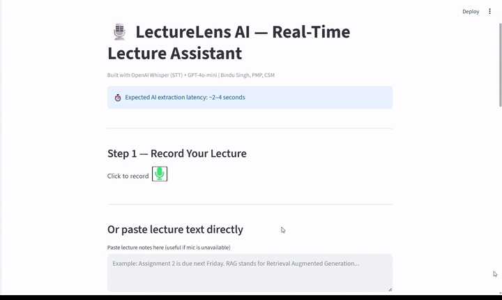

# LectureLens AI

**Turn a recorded lecture or pasted notes into action items, key concepts and downloadable study notes.**

LectureLens AI is an independent Streamlit prototype for learners who want a clearer view of what to do and what to understand after a lecture. OpenAI Whisper transcribes recorded audio; GPT-4o-mini extracts assignments, deadlines, ideas and definitions.

The current implementation uses a record → transcribe → extract workflow. It does not continuously transcribe live audio or provide streaming analysis.

## Demo and product documentation



- [Product requirements document](docs/Lecturelens_AI.pdf)
- [System architecture](docs/lecturelens_system_architecture.svg)
- [User flow](docs/lecturelens_user_flow.svg)

The PRD describes product intent. Implemented functionality and current limitations are documented below.

## The problem

Lecture notes often mix concepts, examples and instructions. Learners must revisit that material to separate assignments and deadlines from the ideas they need to study. LectureLens provides an initial structured draft that the learner can check against the transcript.

## Implemented features

| Feature | Behavior |
|---|---|
| Browser audio recording | Capture microphone audio through a Streamlit recording component |
| Transcription | Send the recording to OpenAI's `whisper-1` model on request |
| Text fallback | Paste lecture text when microphone recording is unavailable |
| Action items | Extract tasks, assignments and stated deadlines |
| Key concepts | Extract important ideas, definitions and frameworks |
| Notes export | Download `lecturelens_notes.md` with both lists and the transcript |
| Session state | Keep transcript and extracted results during Streamlit reruns |

## How it works

1. Record a lecture segment, or paste its text.
2. For recordings, click **Transcribe Audio**.
3. Read the displayed transcript and check for transcription errors.
4. Click **Extract Action Items & Key Concepts**.
5. Review the two lists against the source material.
6. Download the notes as Markdown when results are available.

The extraction prompt asks GPT-4o-mini for JSON containing `action_items` and `key_concepts`. The app parses that response and displays the lists in separate columns. This is prompt-based JSON generation, not enforced schema-based structured output. No RAG or vector database is used in the implemented workflow.

## Local setup

Python 3.10+ is a reasonable starting environment; this repository does not pin or verify a supported Python version. An OpenAI API key with access to the configured models is required for transcription and extraction.

```bash
git clone https://github.com/bs5299-PM/AI-Project-Manager.git
cd AI-Project-Manager/LectureLensAI
python -m venv .venv
```

Activate on Windows PowerShell:

```powershell
.\.venv\Scripts\Activate.ps1
```

Activate on macOS/Linux:

```bash
source .venv/bin/activate
```

### Required corrections in the current checkout

The following source changes are needed before launch. This README does not apply them automatically.

**1. Add the missing recorder dependency.** Add `audio-recorder-streamlit` to `requirements.txt`, then install:

```bash
python -m pip install -r requirements.txt
```

**2. Remove unused imports.** The imports for `requests`, `TextLoader`, `RecursiveCharacterTextSplitter`, `OpenAIEmbeddings`, `Chroma`, `ChatOpenAI`, both `PromptTemplate` imports and `RetrievalQA` are not used by the application. Remove them from `app.py` to avoid startup failures from unused LangChain modules. In particular, `langchain_classic` is imported but is not declared in requirements.

The application only needs the standard-library modules `json`, `tempfile` and `os`, plus `openai`, `streamlit` and `audio_recorder_streamlit`. The existing requirements include additional libraries that the implemented workflow does not need.

**3. Configure the API key outside the source.** Move the existing `import os` above client initialization. Replace `client = OpenAI(api_key="")` with:

```python
api_key = os.getenv("OPENAI_API_KEY")
if not api_key:
    st.error("Set OPENAI_API_KEY before starting LectureLens AI.")
    st.stop()
client = OpenAI(api_key=api_key)
```

Keep the existing `import streamlit as st` above this block. Set the key in the same terminal before launch:

```powershell
# Windows PowerShell — replace the placeholder locally
$env:OPENAI_API_KEY = "YOUR_API_KEY"
```

```bash
# macOS/Linux — replace the placeholder locally
export OPENAI_API_KEY="YOUR_API_KEY"
```

Never commit API keys. This application does not automatically load a `.env` file.

Launch:

```bash
python -m streamlit run app.py
```

Open the local URL printed by Streamlit and allow microphone access if recording. Transcription and extraction use paid API calls; running the interface locally does not make model processing offline.

## Quick text-based walkthrough

In a fresh session, paste:

> Assignment 2 is due Friday. Submit a short explanation of retrieval-augmented generation. RAG retrieves relevant information before generating a response. Next week we will discuss evaluating retrieval quality.

Click **Extract Action Items & Key Concepts**. Check whether the assignment and stated deadline appear under Action Items, and the RAG explanation appears under Key Concepts. Wording may vary between requests; this example is not a benchmark or a guaranteed output.

Download the Markdown notes and compare them with the original text. Relative dates such as “Friday” remain dependent on lecture context; the app does not resolve them against a calendar.

## Project structure

| Path | Purpose |
|---|---|
| `app.py` | Recording, transcription, extraction, UI and Markdown export |
| `requirements.txt` | Python dependencies |
| `assets/lecturelens_demo_short.gif` | Demo recording |
| `docs/Lecturelens_AI.pdf` | Product requirements |
| `docs/lecturelens_system_architecture.svg` | Architecture diagram |
| `docs/lecturelens_user_flow.svg` | User-flow diagram |

## Current limitations

- Audio processing is manually triggered after recording; no continuous streaming or speaker diarization.
- The UI displays an expected extraction latency of roughly 2–4 seconds, but the code does not measure it and no benchmark is included. This is not a latency guarantee.
- No confidence scoring, automatic grounding checks, accuracy benchmark or verified learning-outcome improvement.
- AI may omit tasks, misinterpret statements or introduce unsupported information. Review the transcript and extracted notes before relying on them.
- No in-app editing of the transcript or extracted lists; corrections can be made in downloaded notes.
- Pasted text is copied into session state only when the transcript is empty. Editing the text afterward does not automatically replace that transcript.
- **Start New Session** is shown only when at least one extracted list is nonempty. The pasted-text widget is not explicitly cleared, so remove old text when beginning another session.
- No database, authentication, permanent session archive or calendar integration.
- JSON parsing errors are handled, but API/network errors are not caught. A transcription failure may leave its temporary WAV file on disk because cleanup is not protected by `finally`.
- Audio and transcript content are sent to OpenAI for processing. Use recordings you have permission to process and avoid sensitive material.
- The prompt is oriented toward students with ADHD; the project has no clinical validation and does not establish an accessibility or medical benefit.

## Product decisions demonstrated

- Separate tasks from concepts rather than provide one general summary.
- Offer a text fallback for learners unable to use the microphone.
- Display the source transcript alongside AI-generated notes for human checking.
- Export a portable Markdown artifact rather than require a separate notes service.

This README was checked against the committed source. No live API run or model-quality benchmark was performed during documentation.

## Author

**Bindu Singh, PMP, CSM**

[LinkedIn](https://www.linkedin.com/in/bindu-singh-pmp-csm/) · [Project portfolio](https://github.com/bs5299-PM/AI-Project-Manager)
